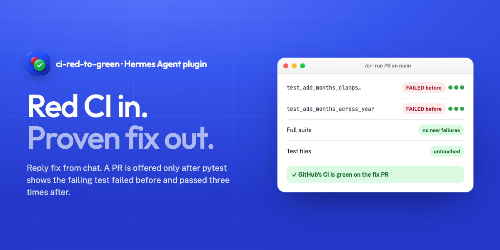

# ci-red-to-green



**Red CI in, proven fix out.**

When your GitHub Actions run goes red, Hermes messages you in chat. Reply `fix` and Hermes reproduces the failure, fixes it, and offers a pull request only after its own pytest output shows the failing test failed before the change and passed three times after it. The PR contains source files only, so GitHub runs your original tests against the fix.

It needs Hermes because the proof comes from Hermes's own terminal results, the first test run goes through Hermes's approval prompt, and the alert, the reply and the Open PR button all happen in the chat you already use.

Site: https://kinnuworks.github.io/ci-red-to-green/ · Demo repo with real fix PRs: https://github.com/kinnuworks/datekit-demo

## Try it in 30 seconds

```bash
hermes plugins install ci-red-to-green --enable
```

1. Make a fine-grained GitHub token for one repo (Actions: read, Contents: read and write, Pull requests: read and write) and save it in Hermes as `CI_RED_TO_GREEN_GITHUB_TOKEN`.
2. In your Telegram chat with Hermes: `/ci watch owner/repo main`
3. Push a commit that breaks a test. When the alert arrives, reply `fix`. When Hermes says it's done, send `/ci` and pick **Open PR** (on Telegram, Hermes numbers the buttons: tap 1).

Needs Hermes 0.23.1 or newer and a Python repo tested with pytest.

## What it checks before it offers a PR

| Check | How |
|---|---|
| The failing test really failed | pytest's own `FAILED <test id>` line, recorded from Hermes's terminal before any source file changed |
| The fix really works | `PASSED <test id>` three runs in a row after the change |
| Nothing else broke | the full suite run before and after: no test that passed before fails after |
| Tests weren't touched | test files, `conftest.py`, pytest/tox/setup config and `.github` are never put in the PR commit; a fix that edits them is refused |
| GitHub agrees | after you open the PR, it follows the PR's own CI run and tells you when it's green |

The plugin never pushes to your base branch and never merges.

## Commands

| Command | What it does |
|---|---|
| `/ci watch owner/repo [branch]` | Start watching a branch (default `main`) |
| `/ci` | Show the proof for the current fix, then Open PR or Discard |
| `/ci status` | What's being watched, and the current incident |
| `/ci stop` | Stop watching |

## What it does on your machine and the network

- **GitHub API:** polls Actions runs for the watched repo every 30 seconds, downloads failed job logs, and (only when you tap Open PR) creates a branch, a commit and a pull request. Uses only `CI_RED_TO_GREEN_GITHUB_TOKEN`. Job logs are downloaded from GitHub's signed log URL without forwarding the token.
- **Shell commands:** the plugin runs none itself. The agent clones the repo into the plugin's data folder and runs pytest through Hermes's terminal tool; the first test run is sent to Hermes's approval prompt, and `git push` from the fix folder is blocked.
- **Stored data:** watch settings, the current incident and the recorded test results live in `plugin-data/ci-red-to-green/` under your Hermes home, plus the cloned repo in `plugin-data/ci-red-to-green/worktrees/`.
- **Background thread:** one polling thread while a watch is on. It stops with `/ci stop` or when Hermes restarts (run `/ci watch` again).
- No telemetry.

## Limits

- Python repos tested with pytest only.
- Tested on Telegram. Other chat platforms get the alert as plain text; `/ci` buttons follow Hermes's picker on each platform.
- Failures that need CI-only secrets, services or another OS can't be reproduced locally, and the plugin says so.
- Flaky tests can still pass three runs in a row.
- Fixes that truly need a test change are refused; make those by hand.
- The fix itself is written by your model, so its quality depends on the model.

## Development

```bash
python -m pip install pytest
python -m pytest -q
```

MIT licensed.
