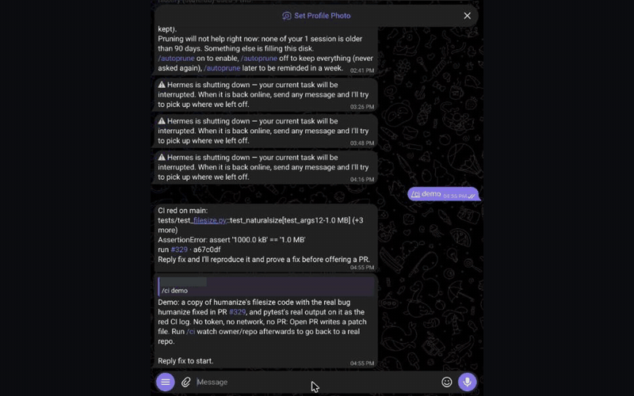
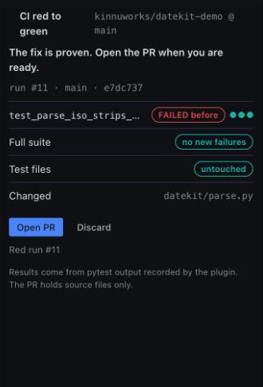
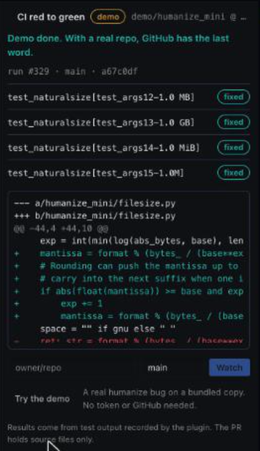

# ci-red-to-green



**Red CI in, proven fix out.**

When your GitHub Actions run goes red, Hermes tells you which test broke and which commit broke it. Reply `fix` and Hermes reproduces the failure and fixes the source. You get a pull request only after its own test output proves three things: each failing test passed at the last green commit, failed twice on the red one, and passed three times in a row with the fix. The PR contains source files only, so GitHub runs your original tests against the fix.

It needs Hermes because the proof comes from Hermes's own terminal results, the first command that runs your repo's code goes through Hermes's approval prompt, and the alert, the reply and the Open PR button live in the chat and the Desktop app you already use.

Site, with a live simulator of the gate: https://kinnuworks.github.io/ci-red-to-green/
Why you can trust the fix: [How the proof works](docs/how-the-proof-works.md)
A real run, in public: [PR #4](https://github.com/kinnuworks/datekit-demo/pull/4) was opened by the plugin after a commit broke five tests. Its table shows each test passed at the last green commit, failed twice before the fix and passed three times after; it holds one source file, and GitHub's checks passed about five minutes after the red run. Earlier runs: [#1](https://github.com/kinnuworks/datekit-demo/pull/1), [#2](https://github.com/kinnuworks/datekit-demo/pull/2), [#3](https://github.com/kinnuworks/datekit-demo/pull/3).

## Try it in 30 seconds, no token needed

```bash
hermes plugins install ci-red-to-green --enable
```

Then send `/ci demo` in any chat with Hermes (or pick **CI red to green: Try the demo** from the Desktop palette) and reply `fix`.

The demo is a trimmed copy of [humanize](https://github.com/python-humanize/humanize)'s file-size code with the real bug humanize fixed in its PR #329: `naturalsize(999999)` returns `1000.0 kB` instead of `1.0 MB`. The tests are humanize's own, and the red "CI log" is pytest's real output on that code, recorded locally. Everything runs locally; Open PR writes the commit as a patch file instead of calling GitHub.

## Use it on your repo

1. Make a fine-grained GitHub token for the repo (Actions: read, Contents: read and write, Pull requests: read and write) and save it in Hermes as `CI_RED_TO_GREEN_GITHUB_TOKEN`.
2. In a chat with Hermes: `/ci watch owner/repo main`, or use the **Watch** field on the Desktop page. Add more repos the same way.
3. When CI goes red, the alert arrives in that chat and as a Desktop notification. Reply `fix`. When the proof is complete, send `/ci` and pick **Open PR** (on Telegram, Hermes numbers the buttons: tap 1), or click **Open PR** in the Desktop pane.

Needs Hermes 0.23.1 or newer, and a repo whose Actions run pytest or `go test`.

## What it checks before it offers a PR

| Check | How |
|---|---|
| It's a regression from those commits | when there was a green run before, the failing test is run once with only the changed source files put back as they were at that green commit; the card and the PR show "PASSED at last green", so the proof reads green before, red after, green with the fix |
| The failure is real | each failing test's own `FAILED` result, twice, recorded from Hermes's terminal before any source file changed |
| It isn't flaky | if the test passes even once before the change, it's reported as flaky and no PR is offered |
| The fix works | `PASSED` three runs in a row after the change |
| Nothing else broke | the full suite run before and after: no test that passed before fails after |
| Tests weren't touched | test files, `testdata`, `conftest.py`, pytest/tox/setup config and `.github` never go in the PR commit; a fix that edits them is refused |
| Only your source goes in | the commit holds files changed since the red commit; files your `.gitignore` files match (nested ones and `!` lines included) stay out unless the repo tracks them |
| Only real runs count | the terminal call must be the test command itself (only `cd`, `source` or variables before it, nothing after it, no pipes), only lines between the runner's own header and summary are read, and Go's cached results are ignored |
| No test edits, even temporary | a run made while a test file or test config is edited never counts, even if the edit is undone later |
| GitHub agrees | after you open the PR, it waits for every workflow on it and tells you when they are all green |

The alert also names the commits that came in since the last green run, and the proof card shows the diff, so you can review the change before you tap Open PR. The plugin never pushes to your base branch and never merges.

## In Hermes Desktop

- **Pane:** the live proof for the current fix: each failing test with its two FAILED-before dots and three PASSED-after dots, the suite and test-file checks, the suspect commit, the diff, and **Open PR** / **Discard**.
- **Page** (sidebar: CI red to green): the same view full width, a field to watch a repo, the queue and earlier incidents.
- **Palette:** Open, Try the demo, Open the proven PR.
- **Status bar chip** and a **native notification** when CI goes red, when a fix is proven and when GitHub's check finishes.

 

Turn it on in **Capabilities → Plugins → CI red to green → Desktop**. It uses only the Desktop plugin SDK and the plugin's own backend routes, and updates live through the plugin's event channel.

## Commands

| Command | What it does |
|---|---|
| `/ci demo` | Run the whole loop on the bundled humanize bug, no token needed |
| `/ci watch owner/repo [branch]` | Watch a branch (default `main`); repeat for more repos |
| `/ci unwatch owner/repo` | Stop watching one repo |
| `/ci` | Show the proof for the current fix, then Open PR or Discard |
| `/ci status` | What's being watched, the current incident and the queue |
| `/ci discard` | Drop the current incident without opening a PR; the next queued one opens |
| `/ci stop` | Stop the watcher |

Also bundled: the `ci-red-to-green:fix-red-ci` skill (the playbook the agent follows) and a **Morning CI check** automation blueprint (`/blueprint morning-ci`).

## What it does on your machine and the network

- **GitHub API:** polls Actions runs for each watched repo every 30 seconds, downloads failed job logs, compares the red commit with the last green one, and (only when you open a PR) creates a branch, a commit and a pull request. Uses only `CI_RED_TO_GREEN_GITHUB_TOKEN`. Job logs are downloaded from GitHub's signed log URL without forwarding the token. `/ci demo` makes no network calls.
- **Shell commands:** the plugin runs none itself. The agent clones the repo into the plugin's data folder and runs the tests through Hermes's terminal tool. The first command in the fix folder that runs the repo's code (the tests, an install, `python`, `make`) goes to Hermes's approval prompt; read-only steps such as `git clone`, `git diff` or `cat` don't, and `git push` from the fix folder is blocked.
- **Stored data:** watches, the current incident, the queue, the last 20 incidents and the recorded test results live in `plugin-data/ci-red-to-green/` under your Hermes home, plus the cloned repos in `plugin-data/ci-red-to-green/worktrees/`.
- **Background thread:** one polling thread while a watch is on. It stops with `/ci stop` or when Hermes restarts; any `/ci` command in that chat starts it again.
- No telemetry.

## Limits

- pytest and `go test` only, on GitHub Actions.
- One fix at a time; red runs from other watched repos wait in a queue.
- Tested on Telegram and Hermes Desktop. Other chat platforms get the alert as plain text; `/ci` buttons follow Hermes's picker on each platform.
- Failures that need CI-only secrets, services or another OS can't be reproduced locally, and the plugin says so.
- The flaky check catches tests that pass before the change; a test can still be flaky in ways five runs don't show.
- Fixes that truly need a test change are refused; make those by hand.
- The fix itself is written by your model, so its quality depends on the model.

## Development

```bash
python -m pip install pytest
python -m pytest -q
```

`tests/test_hermes_e2e.py` also loads the plugin through Hermes's real plugin manager and drives its hooks through the demo. It runs when `HERMES_AGENT_DIR` points at a Hermes checkout.

MIT licensed. The demo sample under `demo/` is from humanize (MIT, see `demo/humanize_mini/LICENCE`).
